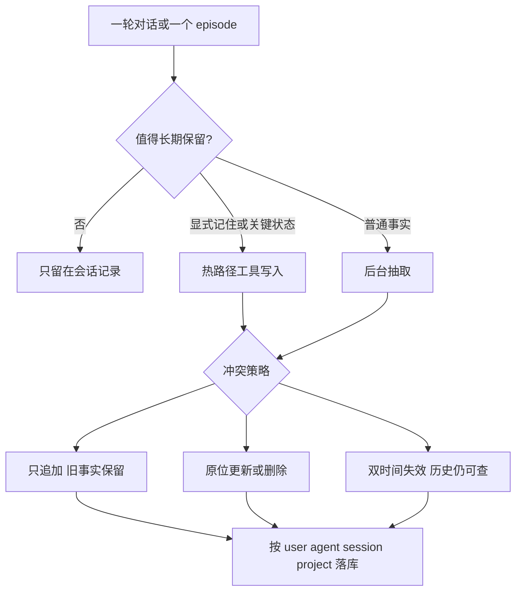

# Agent 记忆设置与写入设计调研

调研截止 2026-11-06。覆盖消费级助手（ChatGPT、Claude）、编码 agent（Claude Code、Cursor），以及被产品直接采用的记忆层（Mem0、Letta / MemGPT、LangGraph / LangMem、Zep Graphiti、Cognee、CrewAI）。结论来自各家当前官方文档与论文，产品开关会随版本变化。

## 1. 业界已经稳定的分层

成熟系统几乎都把「记忆」拆成三层，再叠加一种认知类型。分层决定设置项，类型决定写入格式。

**按存活范围**

- **工作记忆**：当前上下文窗口里正在用的内容。会话结束即失效，靠裁剪、摘要、置顶块来腾位置。Letta 的 memory block、MemGPT 的 working context、LangGraph 的 thread state 都属于这一层。
- **会话记忆**：一次对话或一次 run 的原始记录，可检索，默认不全部塞回提示词。Letta 的 recall、LangGraph checkpointer、各家 chat history 属于这一层。
- **长期记忆**：跨会话保留的事实、偏好、经验和规则。Mem0、Graphiti、Claude topics、ChatGPT saved memories、Claude Code auto memory 属于这一层。

**按认知类型**（LangChain 直接采用 CoALA 的三分法）

- **语义记忆**：关于人或世界的事实。例：「用户在西雅图」「项目截止日期改到 9 月」。
- **情景记忆**：某次经历或某次成功做法。例：「上次用食谱类比讲 Python，用户听懂了」。LangMem 把它做成可检索的 few-shot。
- **程序记忆**：怎么做事的规则。例：系统提示、`CLAUDE.md`、Cursor Rules。多数产品把这一层留给人写，模型只读。

读取方式也只有两种，而且经常同时存在：

- **置顶（push）**：块很小，每次请求都放进提示词。适合偏好、人设、当前任务。
- **检索（pull）**：库可以很大，按当前问题取几条。适合历史事实和文档。

## 2. 记忆设置：各家暴露给人和开发者的旋钮

设置项已经收敛成同一组问题：开不开、写给谁、写成什么、谁能改、敏感内容进不进、满了怎么办。

### 2.1 消费级助手

**ChatGPT**（[Memory](https://help.openai.com/en/articles/8590148-memory-in-chatgpt)、[2025-04 说明](https://openai.com/index/memory-and-new-controls-for-chatgpt/)）

- 两条独立开关：Reference saved memories、Reference chat history。关掉 saved memories 会连带关掉 chat history。
- Saved memories：用户说「记住」或模型自行判断后写入的离散事实，和聊天记录分开存。删聊天不会删记忆；删记忆也不会改写旧聊天里已经出现的句子。
- Chat history：从过往对话里持续改写的有用上下文，没有单独容量上限，内容会随模型判断漂移。关掉后，由历史派生的记忆按 30 天计划删除，原始聊天还在。
- Temporary Chat：这一次对话既不读也不写记忆。
- 用户可搜索、排序、看版本、逐条删除或清空。回答下方可展示本次用到的来源（某条记忆、某次聊天、自定义指令、文件、已连接应用）。
- 自定义指令仍是人手写、始终注入的程序记忆，和自动记忆并列。

**Claude**（[Help Center](https://support.claude.com/en/articles/11817273-use-claude-s-chat-search-and-memory-to-build-on-previous-context)、[产品说明](https://claude.com/resources/articles/claudes-memory-works-everywhere-and-you-decide-whats-in-it)）

- 总开关：Generate memory from chats。Free / Pro / Max 默认开；Team / Enterprise 由组织控制，2026-10-31 之后新建的多数组织默认开。
- 记忆是一组可编辑的 topic，边聊边写。用户可在设置里逐条读、改、删。
- 两个停用档：Pause（保留已有记忆，期间对话不补写）；Reset（永久清空，含项目记忆）。
- 单次免记忆：新对话里关掉 Memory，该次既不读也不写，且开始后不能改。
- 作用域：账号记忆与 Project 记忆分开。项目内同时用两者；可关「Use account memory」让项目完全隔离。Chat 与云端 Cowork 共用一份记忆，本机 Cowork 不用。
- 敏感主题（健康、种族、信仰、政治、性别认同等）默认不写入；用户可打开，打开后只对之后的写入生效，并在每次写入时提示。
- 支持从其他助手导入、导出。导入时由模型抽成独立条目，和工作无关的个人细节可能被丢掉。

### 2.2 编码 agent

**Claude Code**（[官方 memory 文档](https://code.claude.com/docs/en/memory)）

- 人手写的指令：`CLAUDE.md` / `AGENTS.md`，作用域可以是项目、用户、组织。多份文件按「从宽到窄」拼接，彼此叠加。
- 模型自写的 auto memory：每个 git 仓库一份，路径在 `~/.claude/projects/<project>/memory/`，worktree 共用。开关 `autoMemoryEnabled`，本机会话默认开。
- 四类 frontmatter `type`：`user`（角色与偏好）、`feedback`（纠正与被认可的做法）、`project`（代码和 git 推不出来的决策）、`reference`（仓库外的指针，如看板地址）。
- 注入预算：每次会话只加载 `MEMORY.md` 索引的前 200 行或 25KB。索引是一行一个指针，正文在独立 topic 文件里，用到再读。
- 明确不写：能从代码库推导的架构、路径、一次性调试结论；`CLAUDE.md` 里已经写过的规则。

**Cursor**

- 当前支持的持久层是规则，作用域四级：Team Rules、Project Rules（`.cursor/rules` 的 `.mdc`）、User Rules（账号同步）、本机 `~/.cursor/rules`。应用顺序是团队、项目、用户。
- 规则注入模式：始终应用、按 glob、由模型判断相关、被点名时加载。
- 从对话里自动学习的 Memories 在 2.1 起从产品里拿掉，官方引导导出成规则。云端 Automation 另有一份跨 run 的笔记（默认 `MEMORIES.md`），和 IDE 规则不是同一套。
- 含义：编码场景里，团队更信任可 diff、可评审的程序记忆，自动抽取的个人事实退居其次。

### 2.3 记忆平台与框架的开发者设置

**Mem0**（[How it works](https://docs.mem0.ai/core-concepts/how-it-works)、[实体作用域](https://docs.mem0.ai/platform/features/entity-scoped-memory)、[自定义分类](https://docs.mem0.ai/platform/features/custom-categories)）

- 作用域四元组：`user_id`（跟人走）、`agent_id`（跟人设或工具走）、`app_id`（租户或端）、`run_id`（工单、会话、实验，可单独过期）。
- 默认抽取路径按说话人归因：一条事实带 `user_id` 或 `agent_id`，两者不会同时写上。`app_id` 和 `run_id` 会打在该次 `add` 产出的每条记忆上。检索必须带作用域，避免串用户。
- 分类目录可在项目级或单次 `add` 覆盖。单次列表替换项目列表，已写入的记忆不会重打标。默认目录偏生活类（`personal_details`、`user_preferences` 等 15 类），产品应换成自己的词表。
- 检索过滤支持 AND / OR / NOT，以及分类、metadata、过期记忆是否可见。
- 存储拆三处：SQL 存事实与审计、向量库存嵌入、实体库做图上的关联。

**Letta**（[Memory blocks](https://www.letta.com/blog/memory-blocks/)、[Archival](https://docs.letta.com/v1-sdk/memory/archival-memory/index.md)、[Sleep-time](https://www.letta.com/blog/sleep-time-compute/)）

- 每个 block 的设置：`label`、`description`（告诉模型这块该写什么）、`value`、字符 `limit`、是否只读。只读块只能由开发者改。
- 多 agent 可共享同一 block，改一次全员可见。
- 三层工具权限不同：core block 可改写；recall 自动落盘、按需搜索；archival 默认 agent 难改难删，开发者用 SDK 管，适合「写进去就当证据」的知识。
- Sleep-time 模式把「对话」和「整理记忆」拆成两个 agent。主 agent 可以不拿 core 编辑工具，整理 agent 在空闲时重写主 agent 的块。

**LangGraph / LangMem**（[Memory 概念](https://docs.langchain.com/oss/python/concepts/memory)、[memory manager](https://langchain-ai.github.io/langmem/reference/memory/)）

- 短期：thread + checkpointer。长期：Store，命名空间自定，常见是 `(memories, user_id, 类型)`。
- 写入权限三个开关：`enable_inserts`（默认开）、`enable_updates`（默认开）、`enable_deletes`（默认关）。热路径工具还可把 `actions_permitted` 收成 `create` / `update` 的子集。
- schema 用 Pydantic 约束字段，避免自由文本事后无法过滤。

**Graphiti / Zep**（[概览](https://help.getzep.com/graphiti/getting-started/overview)）

- 写入单位是 episode，带来源类型：`text`、`json`、`message`。
- `group_id` 做隔离；同一 group 的 episode 排队串行，避免并发把同一事实写乱。
- 本体可预设（Pydantic 实体和边类型）或让图自己长出来。
- 事实带双时间：现实时间 `valid_at` / `invalid_at`，系统时间 `created_at` / `expired_at`。检索默认可问「现在为真」或「当时为真」。

**CrewAI**（[Memory](https://docs.crewai.com/edge/en/concepts/memory)）

- 统一 `Memory` 对象，保存时可由模型补 `scope`、`categories`、`importance`。
- 召回按语义、新近、重要度复合打分，并有深度档位。
- 先 `extract_memories` 把一大段输出拆成原子句，再逐条 `remember`，避免一整段任务输出变成一条不可检索的记忆。

**Cognee**

- 新入口是 `remember()`，把旧的 add、cognify、memify 收成一次写入。
- 流水线：文档分类、分块、先建可检索 chunk，再用模型抽实体和边，最后写摘要与向量。chunk 用内容哈希，重复处理不会再次嵌入。
- 数据集有所有权和权限。图建好之后的巩固（合并实体、派生事实）走单独的 enrichment，不再把原始语料重灌一遍。

## 3. 记忆写入设计

写入设计比「用哪个向量库」分叉更大。成熟方案落在四条路径上，差别在于谁决定写、冲突时改不改旧记录、写在不在用户等待路径上。

### 3.1 热路径：模型在回复前自己调用写入工具

代表：ChatGPT 的保存记忆工具、Letta 的 `memory_insert` / `memory_replace` / `memory_rethink`、LangMem 的 `manage_memory(action=create|update|delete)`。

流程是：模型看到本轮内容，判断要不要记，调用工具，存储立刻可见，然后再继续回答。Letta 把 core memory 编进下一次提示词，所以写入等于改写了 agent 的常驻上下文。

适合：用户明确说「记住」、必须在下一句就生效的称呼或偏好、当前任务的 scratchpad。

代价：多一次工具调用和一次「要不要记」的判断，延迟加在用户等待上；模型同时还要完成原任务，记忆质量会波动。MemGPT 论文把这套自管理写成系统提示里的两段说明：记忆层级各自干什么，以及每个函数的 schema。

Letta 后来的修正是把重写移出热路径。主 agent 在对话中做小更新；sleep-time agent 在会话后用 `memory_rethink` 做整块重写、去重和归档。官方建议多数场景仍把 archival 的插入放在主 agent，否则用户会在整理完成前感觉 agent 健忘。

### 3.2 后台抽取：先回答，再蒸馏

代表：Mem0、LangGraph memory template 的 debounce、CrewAI 的 EncodingFlow、Cognee 的 cognify。

**Mem0 当前算法（v3）**是这一派里最值得单独立住的一次转向：

1. 对话先返回给用户，抽取异步开始。
2. 查已有相关记忆，供去重。
3. 一次模型调用只做 ADD，抽出偏好、决定、计划等可复用事实。
4. 哈希去重，再嵌入。
5. 抽实体（专有名词、引号内容、复合名词）并连到图上。
6. 另一条异步通道补时间元数据：事件发生时间、进行中还是已完成、时间精度、类型（event、state、plan、preference、relationship、absence）。

他们放弃了上一代的「抽取后再做 ADD / UPDATE / DELETE 合并」。合并慢，而且覆盖和删除会把后来仍有用的旧事实毁掉。新事实与旧事实并存，时间元数据留给检索去判断哪条对当前问题有效。agent 自己说出的事实（「航班已订在 3 月 3 日」）和用户原话同一权重，上一代经常把 agent 侧事实丢掉。

官方对调用方的写入纪律：只把以后还会用的东西送进 `add`（偏好、决定、账户事实、目标、稳定反馈）；密钥和未脱敏隐私不进库。

**LangGraph 模板的触发器**用 debounce：每轮回答后预约一次记忆更新；若间隔内又来消息，取消上一次，重新计时。安静下来才写，避免逐句抽取。其他常见触发是 cron、会话结束、用户手动。

**CrewAI EncodingFlow** 把一次批量写入拆成五步：一次嵌入全部候选、批内余弦去重、并行找库里的相似项、并行让模型做字段补全和合并计划、再批量重嵌入并一次 bulk write。模型失败时降级，写入仍能落，只是少了 scope 和重要度。

### 3.3 时序图：新事实进来，旧事实失效但不删除

代表：Graphiti。Zep 在企业侧用同一套图，并加上治理和租户。

一条 episode 的写入顺序：

1. 原始内容连同参考时间入库，保留溯源。同一 `group_id` 串行处理。
2. 抽出实体和边。边可以来自预设本体，也可以现场学习。
3. 用 episode 的参考时间把「两年前」「6 月 20 日」解析成 `valid_at` / `invalid_at`。
4. 和库中相似边比对。语义相同则给旧边补上这条 episode 的引用。
5. 模型判定矛盾后，按现实时间决定谁被取代：较早的事实写下 `invalid_at`（被新事实的生效时间截断）和 `expired_at`（系统发现它过时的时刻）。边留在图里。
6. 被取代事实的自然语言有时会改写成过去时，例如「Maria 曾是初级经理，直到升为高级经理」。乱序到达的 episode 也靠 `valid_at` 而不是入库顺序对齐。

检索不靠模型重排，而是向量、BM25、图遍历一次融合，并可按时间过滤。这和 Mem0 v3 的动机相同：历史要留着；差别是 Graphiti 在写入时就把「当前是否有效」标好，Mem0 把这个判断更多留给检索。

### 3.4 文件即记忆：写入就是改一份受预算约束的 Markdown

代表：Claude Code auto memory；Cursor 规则是同一形态的人手写版本。

Claude Code 的写入协议：

1. 判断这条信息对未来会话有没有用。能从仓库推导的不写，指令文件里已有的不写。
2. 先查有没有可更新的 topic，避免再开一份重复文件。
3. 写入独立 Markdown，frontmatter 含 `name`、`description`、`type`。
4. 在 `MEMORY.md` 加一行指针（约 150 字符内）。索引本身不放正文。
5. 写完后若索引接近 200 行或 25KB，模型被要求改短。超过预算的行下次会话加载时会被截掉。

错了就改原文件或删掉，按主题组织，不按时间线堆。人可以通过 `/memory` 直接改这些文件。

这套设计把「程序记忆」和「学习笔记」都放进 git 或用户目录，审查成本和普通文档一样。代价是没有向量检索，预算一满就必须人工或模型做遗忘。

### 3.5 冲突策略对照

四条路径对「用户改口」的处理已经形成三种稳定策略：

- **只追加**（Mem0 v3）：新旧都留，用时间和检索打分决定展示哪条。信息损失最小，提示词里可能同时出现矛盾句，调用方要自己取「当前有效」的子集。
- **原位更新，删除默认关闭**（LangMem、Letta block、ChatGPT saved memories）：同一 id 被改写，用户也能下令删除。简单，但覆盖不可逆，所以删除要显式打开，并留 30 天左右的删除日志（ChatGPT 对已删 saved memories 的做法）。
- **失效保留**（Graphiti）：当前视图干净，历史查询仍成立，每条事实能追回 episode。写入时模型调用更多（抽边、抽时间、判矛盾）。

Letta 的 archival 更接近第四种：**追加且 agent 难以改删**。常变状态放 block，稳定知识放 archival。

### 3.6 写入前的共同过滤器

各家文档反复出现同一张清单，适合直接当成写入策略：

- 写：稳定偏好、身份与角色、已确认的决定、用户纠正、agent 已执行并告知用户的动作、无法从环境重新推导的项目事实、外部系统的指针。
- 不写：密钥和令牌、未脱敏的敏感原文、可以从代码或数据库现查的事实、一次性调试过程、闲聊、模型自己没被确认的推测。
- 敏感类目默认关闭，打开后只向前生效，并在写入时告知用户。
- 一条记忆一件事。先抽取原子事实，再入库。CrewAI 和 Mem0 都这么做。
- 写入前先找相似项。哈希去重（Mem0）、余弦去重（CrewAI）、语义相同则合并引用（Graphiti）、先读再改（Claude Code、Letta sleep-time 的 search-before-insert）。
- 每条记录带说话人、来源消息、写入时间、作用域。没有作用域的 `search` 在 Mem0 里会被拒绝。
- 给用户一个不写入的通道：Temporary Chat、本轮关闭 Memory、Pause。
- 给用户读、改、删、导出的入口。记忆写了但不可见，是 ChatGPT 早期 chat-history 记忆被批评的点；Claude 和 Claude Code 都把「逐条可见」做成默认。

## 4. 可以照着落地的组合

如果要做一套新的 agent 记忆，成熟产品叠在一起的最小闭环是：

1. **程序记忆人手写、始终注入、可版本管理。** 对应 Claude 的项目说明、Cursor Rules、`CLAUDE.md`。模型默认只读。
2. **一小块置顶工作记忆。** 有 label、description、字符上限，只放当前用户偏好和本任务状态。热路径只允许 insert 和有限 replace。
3. **长期事实走后台、只追加或双时间失效。** 会话安静后再抽取；显式「记住 / 忘掉」才走热路径。删除默认关，或做成失效而不是物理删除。
4. **作用域至少分 user、agent、session。** 项目或租户再加一维。检索强制带过滤。
5. **类型用受控词表。** 语义事实、情景经历、外部引用分开存。分类在写入时打上，改词表不追溯旧数据。
6. **注入预算写死。** 置顶块有字符上限；检索条数和 token 有上限；文件型记忆有行数或体积上限，超出就要求巩固，而不是静默截断后假装还记得。
7. **用户控制四个状态。** 正常读写、本轮不读写、暂停读写但保留、清空。敏感类目单独开关。

热路径负责「下一句就要对」，后台负责「库要干净」，图或时间戳负责「改口之后旧事实还在」。只选其中一个，会在延迟、遗忘或矛盾里踩到这三家已经踩过的坑。

## 5. 来源

- Mem0：[How Mem0 Works](https://docs.mem0.ai/core-concepts/how-it-works)、[Memory Evaluation](https://docs.mem0.ai/core-concepts/memory-evaluation)、[v3 算法说明](https://mem0.ai/blog/mem0-the-token-efficient-memory-algorithm)、[实体作用域](https://docs.mem0.ai/platform/features/entity-scoped-memory)
- Letta：[Memory blocks](https://www.letta.com/blog/memory-blocks/)、[Agent memory](https://www.letta.com/blog/agent-memory/)、[Sleep-time compute](https://www.letta.com/blog/sleep-time-compute/)、[MemGPT 论文](https://arxiv.org/html/2310.08560v2)
- LangChain：[Memory overview](https://docs.langchain.com/oss/python/concepts/memory)、[LangMem manager](https://langchain-ai.github.io/langmem/reference/memory/)、[memory template 的 debounce](https://github.com/langchain-ai/memory-template)
- Graphiti / Zep：[Overview](https://help.getzep.com/graphiti/getting-started/overview)、[双时间模型](https://www.getzep.com/blog/beyond-static-knowledge-graphs/)
- OpenAI：[Memory FAQ](https://help.openai.com/en/articles/8590148-memory-in-chatgpt)
- Anthropic：[Claude memory](https://support.claude.com/en/articles/11817273-use-claude-s-chat-search-and-memory-to-build-on-previous-context)、[Claude Code memory](https://code.claude.com/docs/en/memory)
- CrewAI：[Memory](https://docs.crewai.com/edge/en/concepts/memory)
- Cognee：[Cognify](https://docs.cognee.ai/core-concepts/main-operations/legacy-operations/cognify)
- Cursor：规则文档与 2.1 起 Memories 退出产品、改为导出到 Rules 的官方论坛说明
