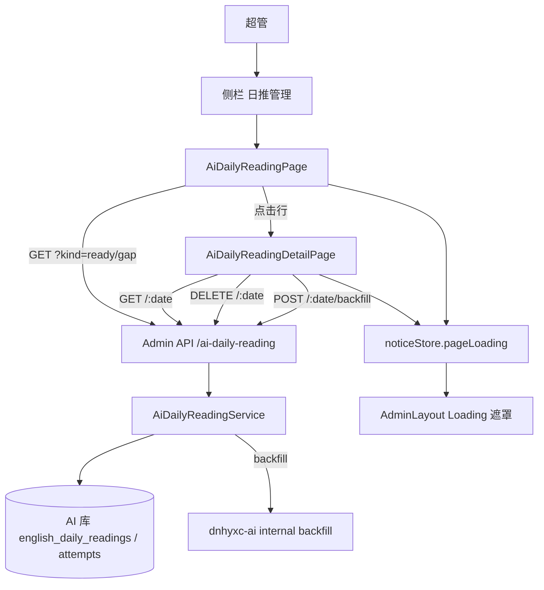

# 日推管理（功能实现详解与复刻指南）

> **一句话**：超管在后台查看系统日推的成功/失败日历表，点进某一天看文章与生成记录，失败日可一键请求主项目补生成，成功日可删除。  
> **入口**：侧栏「前台 → 日推管理」→ `/ai-daily-reading`；详情 `/ai-daily-reading/:publishDate`  
> **关联文件**：见 §0.4 文件地图  
> **文档目标**：读懂后台日推管理整套实现；可按复刻手册在另一管理后台对接同类业务库表与补生成接口  
> **非目标**：不写主项目（`dnhyxc-ai`）里 LLM 生成日推、队列工人、定时任务的实现；不写普通用户按账号隔离（本接口仅 `Role.ADMIN`）

---

## 0. 先看这里（必填，一眼建立模型）

### 0.1 30 秒读懂

- **做什么**：把 AI 业务库里的「系统日推」（`slot = day`）做成后台管理：成功列表、缺口/失败列表、详情预览、删除成功篇、对失败日发起补生成、手动刷新与全页 Loading。
- **不做什么**：不在后台本机生成文章；补生成只是带内部密钥调用主项目 `POST /api/internal/daily-reading/backfill`。
- **关键角色**：前端 Tabs/Table/详情 UI；`noticeStore` 管全页遮罩；Nest 控制器鉴权并转发；Service 读业务库两张表并算缺口状态；环境变量指向主项目内部接口。

### 0.2 功能点总表（必填）

| 编号 | 功能点（人话） | 用户可感知表现 | 关键实现位置（文件 → 符号） | 正文小节 |
|------|----------------|----------------|------------------------------|----------|
| F1 | 菜单与路由挂上「日推管理」 | 侧栏可见入口，可进列表/详情 | `menu.ts`、`router/index.tsx` | §4.1 |
| F2 | 后端模块挂到 AI 库 | 接口可用（需 AI_DB） | `ai-daily-reading.module.ts`、`app.module.ts`、`typeorm-ai.config.ts` | §4.2 |
| F3 | 实体映射两张业务表 | 能读日推与尝试记录 | `ai-daily-reading.entity.ts`、`*-attempt.entity.ts` | §4.3 |
| F4 | 成功列表 | 「成功」Tab 表格 | `listReady` + `AiDailyReadingPage` | §4.4 |
| F5 | 失败/缺口列表 | 「失败」Tab 表格 | `listGaps` + `gapStatus` | §4.5 |
| F6 | 手动刷新当前列表 | 说明栏右侧刷新图标 | `AiDailyReadingPage` 刷新按钮 | §4.6 |
| F7 | 全页 Loading 与其它页一致 | 遮罩「加载中…」 | `noticeStore.setPageLoading` | §4.7 |
| F8 | 详情：文章 + 生成记录 | 点行进入详情页 | `getDay` + `AiDailyReadingDetailPage` | §4.8 |
| F9 | 英文正文挂逐词释义 | 点词弹出中文 | `glossParagraphs`、`GlossText` | §4.9 |
| F10 | 删除已成功日推 | 列表/详情删除 | `removeReady` | §4.10 |
| F11 | 失败日补生成 | 「立即补生成」入队 | `backfill` + 环境变量 | §4.11 |
| F12 | 仅超管可调接口 | 普通用户 403 | Controller `@Roles(Role.ADMIN)` | §4.12 |

### 0.3 架构一图（必填）



### 0.4 文件地图与建造顺序（必填）

| 建造序 | 文件 | 职责（一句话） | 依赖 |
|--------|------|----------------|------|
| 1 | `ai-daily-reading.entity.ts` | 映射日推主表 | AI 库表已存在 |
| 2 | `ai-daily-reading-attempt.entity.ts` | 映射生成尝试表 | AI 库表已存在 |
| 3 | `typeorm-ai.config.ts` | 注册两实体到 AI 连接 | 1、2 |
| 4 | `ai-daily-reading.service.ts` | 列表/详情/删除/补生成业务 | 1、2 |
| 5 | `ai-daily-reading.controller.ts` | HTTP + 超管鉴权 | 4 |
| 6 | `ai-daily-reading.module.ts` | Nest 模块组装 | 3–5 |
| 7 | `app.module.ts` | `AI_DB_ENABLED` 时导入模块 | 6 |
| 8 | `app-config.factory.ts` + `.env*.example` | 补生成 URL/Token 可选配置 | 无 |
| 9 | `service/api.ts` + `service/index.ts` | 前端 API 封装 | 5 |
| 10 | `router/menu.ts` + `router/index.tsx` | 菜单与路由 | 9 |
| 11 | `AiDailyReadingPage.tsx` | 双 Tab 列表 + 刷新 + Loading | 9、10 |
| 12 | `AiDailyReadingDetailPage.tsx` | 详情、释义、删除/补生成 | 9、10 |

---

## 1. 人话版：用户旅程（必填）

1. **进入**：超管打开「日推管理」，默认「成功」Tab，全页 Loading 后出现已生成成功的日期表格；说明文案右侧有刷新图标。
2. **主路径（看成功篇）**：点某一行 → 详情页展示英文标题/正文（可点词看释义）、中文折叠、词汇/语法/理解题、下方「生成记录」；可删除该天日推，删除后回到成功列表。
3. **分支（看失败/缺口）**：切到「失败」Tab → 看到从最早系统日推日到今天、尚未 ready 的日期及原因；点行进详情；若配置了主项目内部地址，可点「立即补生成」入队，再刷新列表。
4. **离开**：返回列表；切 Tab 会带 `?tab=`，详情返回时保留 Tab。

---

## 2. 问题与解决方案总表（必填）

| 问题编号 | 现象 / 风险（人话） | 根因 | 解决方案（本项目做法） | 对应功能点 |
|----------|---------------------|------|------------------------|------------|
| P1 | 业务库表被后台改结构 | Admin 若 `synchronize: true` 会动业务表 | AI 连接强制 `synchronize: false`，实体只映射所需列 | F2、F3 |
| P2 | 「失败」列表不知道缺哪几天 | 库里只有有行的日期 | 从最早 `publish_date` 枚举到上海时区「今天」，再去掉 ready | F5 |
| P3 | pending/刚失败被当成可补生成 | 工人还在跑或冷却中 | `gapStatus`：pending→generating；失败且未满 3 分钟→generating；满 5 次→exhausted | F5、F11 |
| P4 | 后台自己生成文章成本高 | 生成逻辑在主项目 | 只调内部 backfill，失败映射中文 reason | F11 |
| P5 | Table 自带转圈和其它页不一致 | 日推列表曾用 `loading={loading}` | 统一 `noticeStore.setPageLoading` | F6、F7 |
| P6 | 普通用户误删系统日推 | 接口过宽 | Controller 仅 `@Roles(Role.ADMIN)` | F12 |

---

## 3. 实现思路总览（必填）

### 3.1 总体策略

后台是**只读管理面 + 少量写操作**（删成功篇、触发补生成）。日推正文与尝试历史落在 AI 库；生成状态机在主项目，后台用 `gapStatus` 做**展示态**合成。列表按 `kind` 拆成两个查询，避免一张表硬塞两种语义。

### 3.2 数据流与控制流

- 列表：`kind=ready|gap` → Service → 表 `english_daily_readings`（`slot=day`）+ attempts 聚合 tokens。
- 详情：按 `publishDate` 取一行 + 全部 attempts；ready 才带 `passage`。
- 删除：仅 `status===ready`；同时删 attempts，该日会重新出现在缺口列表。
- 补生成：校验日期 → `fetch` 主项目 → 按 HTTP/业务 reason 抛中文异常。

### 3.3 模块职责

- **Controller**：鉴权、路由参数、选 `listReady`/`listGaps`。
- **Service**：日历缺口算法、详情组装、删除、HTTP 补生成。
- **前端列表**：Tab 状态进 URL；刷新调同一 `load(tab)`。
- **前端详情**：PassageView 负责展示；AttemptList 负责时间线。

---

## 4. 分功能点详解（必填，核心）

### 4.1 F1：菜单与路由挂上「日推管理」

#### （1）人话说明

超管在侧栏「前台」分组里看到「日推管理」，点进去是列表；点表格行进入带日期的详情页。

#### （2）实现思路

与书籍列表等前台模块一致：硬编码 `menuItems` + `createBrowserRouter` 子路由。详情把当前 Tab 放进 query，方便返回。

#### （3）问题与对策

无独立踩坑。注意：种子菜单未写入「日推管理」路径时，若侧栏改为严格按 `roles.menus` 过滤且未分配，超管仍靠 `isSuperAdmin` 看全量菜单。

#### （4）实现过程

1. 在 `menu.ts` 的 frontend 分组增加路径与图标。  
2. 在 `router/index.tsx` 注册列表与详情路由。

#### （5）关键代码（逐行上方注释）

- **位置**：`apps/frontend/src/router/menu.ts`（frontend children）

```typescript
// 前台分组下新增日推管理叶子菜单
{ path: '/ai-daily-reading', label: '日推管理', icon: CalendarDays },
```

- **位置**：`apps/frontend/src/router/index.tsx`

```typescript
// 列表页：成功/失败双 Tab
{ path: 'ai-daily-reading', element: <AiDailyReadingPage /> },
// 详情页：路径参数为发布日 YYYY-MM-DD
{
	path: 'ai-daily-reading/:publishDate',
	element: <AiDailyReadingDetailPage />,
},
```

#### （6）复刻提示

- 可原样搬：路径命名、双路由拆分。  
- 须替换：图标组件、侧栏数据结构。  
- 最小验证：登录超管后侧栏能点进空表或有数据表。

---

### 4.2 F2：后端模块挂到 AI 库

#### （1）人话说明

只有开启 AI 业务库时，日推接口才存在；实体挂在名为 `ai` 的 TypeORM 连接上。

#### （2）实现思路

与 `AiEbookModule` 相同：`TypeOrmModule.forFeature(..., DB_CONNECTIONS.AI)`，并在 `AppModule` 的 `AI_DB_ENABLED` 分支导入。

#### （3）问题与对策

对应 P1：业务库禁止 sync。

#### （4）实现过程

1. 写 Module 注册仓储。  
2. `typeorm-ai.config` 的 `entities` 数组追加两实体。  
3. `app.module` 条件导入。

#### （5）关键代码（逐行上方注释）

```typescript
// Nest 模块：日推管理
@Module({
	imports: [
		// 两实体挂到 AI 命名连接，而不是 Admin 主库
		TypeOrmModule.forFeature(
			[AiDailyReading, AiDailyReadingAttempt],
			DB_CONNECTIONS.AI,
		),
		// RoleGuard 需要 UserService
		UserModule,
	],
	controllers: [AiDailyReadingController],
	providers: [AiDailyReadingService, RoleGuard],
})
export class AiDailyReadingModule {}
```

```typescript
// AppModule：仅当 AI 库启用时挂载日推模块
...(AI_DB_ENABLED
	? [
			// …其它 AI 模块
			AiDailyReadingModule,
			// …
		]
	: []),
```

#### （6）复刻提示

- 可移植：条件导入 + 命名连接。  
- 须替换：连接名常量、是否允许无库启动。

---

### 4.3 F3：实体映射两张业务表

#### （1）人话说明

一张表存「某一天系统日推」正文与状态；另一张表存每次生成尝试的耗时、token、成败原因。

#### （2）实现思路

只映射后台用到的列；唯一索引 `(publishDate, slot)` / `(publishDate, attemptNo)` 与业务库一致。`slot` 默认 `day`，手动篇其它 slot 不进本管理。

#### （3）问题与对策

对应 P1。注释写明「业务库禁止 synchronize」。

#### （4）实现过程

1. 建 `AiDailyReading`。  
2. 建 `AiDailyReadingAttempt`。

#### （5）关键代码（逐行上方注释）

```typescript
/** 只映射列表和详情要用的列。业务库禁止 synchronize。 */
@Entity('english_daily_readings')
// 同一天同一 slot 只能有一条
@Index('uq_english_daily_readings_publish_slot', ['publishDate', 'slot'], {
	unique: true,
})
export class AiDailyReading {
	// UUID 主键
	@PrimaryGeneratedColumn('uuid')
	id!: string;

	// 发布日字符串 YYYY-MM-DD
	@Column({ name: 'publish_date', type: 'varchar', length: 10 })
	publishDate!: string;

	// 系统日推固定 slot=day；手动篇用其它 slot
	@Column({ type: 'varchar', length: 36, default: 'day' })
	slot!: string;

	// ready / pending / failed 等
	@Column({ type: 'varchar', length: 16 })
	status!: string;

	// 本轮开始时间（用于「刚失败算 generating」）
	@Column({ name: 'started_at', type: 'datetime', precision: 6 })
	startedAt!: Date;

	// 主题标签
	@Column({ type: 'varchar', length: 32, default: '' })
	theme!: string;

	// 已尝试次数
	@Column({ name: 'attempt_count', type: 'int', default: 0 })
	attemptCount!: number;

	// 最近错误摘要
	@Column({ name: 'last_error', type: 'varchar', length: 500, nullable: true })
	lastError!: string | null;

	// 英文标题
	@Column({ name: 'title_en', type: 'varchar', length: 80, default: '' })
	titleEn!: string;

	// 中文标题
	@Column({ name: 'title_zh', type: 'varchar', length: 80, default: '' })
	titleZh!: string;

	// 英文正文
	@Column({ name: 'body_en', type: 'text' })
	bodyEn!: string;

	// 中文正文
	@Column({ name: 'body_zh', type: 'text' })
	bodyZh!: string;

	// 来源类型，默认 llm
	@Column({ name: 'source_kind', type: 'varchar', length: 8, default: 'llm' })
	sourceKind!: string;

	// 来源链接（可空）
	@Column({ name: 'source_url', type: 'varchar', length: 500, nullable: true })
	sourceUrl!: string | null;

	// 来源标题（可空）
	@Column({
		name: 'source_title',
		type: 'varchar',
		length: 200,
		nullable: true,
	})
	sourceTitle!: string | null;

	// 附加 JSON：词汇/语法/理解题/wordGloss 等
	@Column({ type: 'json', nullable: true })
	extras!: Record<string, unknown> | null;

	// 创建时间（成功列表「生成时间」列）
	@Column({ name: 'created_at', type: 'datetime', precision: 6 })
	createdAt!: Date;
}
```

```typescript
// 每次生成尝试一行
@Entity('english_daily_reading_attempts')
@Index('uq_english_daily_reading_attempts', ['publishDate', 'attemptNo'], {
	unique: true,
})
export class AiDailyReadingAttempt {
	@PrimaryGeneratedColumn({ type: 'bigint' })
	id!: string;

	@Column({ name: 'publish_date', type: 'varchar', length: 10 })
	publishDate!: string;

	@Column({ name: 'attempt_no', type: 'int' })
	attemptNo!: number;

	@Column({ name: 'enqueued_at', type: 'datetime', precision: 3 })
	enqueuedAt!: Date;

	@Column({ name: 'started_at', type: 'datetime', precision: 3 })
	startedAt!: Date;

	@Column({ name: 'finished_at', type: 'datetime', precision: 3 })
	finishedAt!: Date;

	@Column({ name: 'elapsed_ms', type: 'int', default: 0 })
	elapsedMs!: number;

	@Column({ type: 'int', default: 0 })
	tokens!: number;

	@Column({ type: 'varchar', length: 16 })
	outcome!: string;

	@Column({ type: 'varchar', length: 500, nullable: true })
	reason!: string | null;
}
```

#### （6）复刻提示

表名/列名必须与业务库一致；Admin 实体是只读映射，不是建表脚本。

---

### 4.4 F4：成功列表

#### （1）人话说明

「成功」Tab 只显示 `slot=day` 且 `status=ready` 的行，按日期倒序，并汇总该日 attempts 的 token。

#### （2）实现思路

`listReady` 查主表，再 `tokenUsage` 按日期 SUM；前端 `kind=ready`。

#### （3）问题与对策

无；边界：无数据返回空数组。

#### （4）实现过程

1. Service `find` ready + 聚合 tokens。  
2. Controller `kind === 'ready'` 分支。  
3. 前端 Tab 与 Table 绑定。

#### （5）关键代码（逐行上方注释）

```typescript
// 已经写成 ready 的系统日推；手动篇 slot 不是 day，不在这里
async listReady() {
	// 只取系统日推且已成功
	const rows = await this.days.find({
		where: { slot: DAY, status: 'ready' },
		order: { publishDate: 'DESC' },
	});
	// 没有成功篇直接空
	if (!rows.length) return [];
	// 批量汇总每天 token，避免 N+1
	const usage = await this.tokenUsage(rows.map((row) => row.publishDate));
	// 组装前端表格行
	return rows.map((row) => ({
		publishDate: row.publishDate,
		status: 'ready' as const,
		theme: row.theme,
		titleEn: row.titleEn,
		titleZh: row.titleZh,
		attemptCount: row.attemptCount ?? 0,
		tokens: usage.get(row.publishDate)?.tokens ?? 0,
		createdAt: row.createdAt,
	}));
}
```

```typescript
// 控制器：query.kind 决定列表语义
@Get()
list(@Query('kind') kind?: string) {
	return kind === 'ready'
		? this.dailyReading.listReady()
		: this.dailyReading.listGaps();
}
```

#### （6）复刻提示

列表 API 用 query 区分语义，比两个路径更省事；聚合可用 SQL SUM。

---

### 4.5 F5：失败/缺口列表

#### （1）人话说明

「失败」Tab 展示从最早系统日推日到「上海今天」之间所有**还没成功**的日期：库中没有行叫缺失，pending/刚失败叫生成中，失败满 5 次叫已耗尽。

#### （2）实现思路

`shanghaiToday` + `eachDate` 展开日历；`gapStatus` 合成展示态；过滤掉 ready 后 `reverse` 让新日期靠前。

#### （3）问题与对策

对应 P2、P3。

#### （4）实现过程

1. 取最早 publishDate。  
2. Between 拉区间内主表行。  
3. 聚合 attempts。  
4. 逐日 `gapStatus` 并过滤。

#### （5）关键代码（逐行上方注释）

```typescript
// 用上海时区算「今天」，避免服务器 UTC 日期错一天
function shanghaiToday(now = new Date()): string {
	return new Intl.DateTimeFormat('en-CA', {
		timeZone: 'Asia/Shanghai',
		year: 'numeric',
		month: '2-digit',
		day: '2-digit',
	}).format(now);
}

// 闭区间展开 YYYY-MM-DD 列表（按 UTC 午夜步进，字符串已是日历日）
function eachDate(start: string, end: string): string[] {
	const out: string[] = [];
	const cur = new Date(`${start}T00:00:00Z`);
	const last = new Date(`${end}T00:00:00Z`);
	while (cur.getTime() <= last.getTime()) {
		out.push(cur.toISOString().slice(0, 10));
		cur.setUTCDate(cur.getUTCDate() + 1);
	}
	return out;
}

// 把库状态折成后台展示态
function gapStatus(
	row: AiDailyReading | undefined,
	now: number,
): 'missing' | 'generating' | 'exhausted' | 'failed' | 'ready' {
	// 库里没有这一天 → 缺失
	if (!row) return 'missing';
	// 已成功
	if (row.status === 'ready') return 'ready';
	// 排队/生成中
	if (row.status === 'pending') return 'generating';
	// 非 failed 的其它异常统一当 failed
	if (row.status !== 'failed') return 'failed';
	// 达到最大尝试次数 → 已耗尽
	if ((row.attemptCount ?? 0) >= MAX_ATTEMPTS) return 'exhausted';
	// 刚失败未满 3 分钟仍显示生成中，避免连点补生成
	const age = now - new Date(row.startedAt).getTime();
	if (age < GENERATING_MS) return 'generating';
	return 'failed';
}
```

#### （6）复刻提示

时区与「今天」算法必须与主项目日推日历一致，否则缺口会多一天或少一天。

---

### 4.6 F6：手动刷新当前列表

#### （1）人话说明

说明文案右侧刷新图标，点击重新请求当前 Tab 的列表。

#### （2）实现思路

复用 `load(tab)`，不另写接口。

#### （3）问题与对策

无；注意加载中仍走全页遮罩（F7）。

#### （4）实现过程

1. 说明行改为左右布局。  
2. 按钮 `onClick={() => load(tab)}`。

#### （5）关键代码（逐行上方注释）

```typescript
// 说明与刷新同一行：左文案、右图标
<div className="flex items-center justify-between gap-4">
	<Typography.Text type="secondary">
		{/* 按 Tab 切换提示文案 */}
		{tab === 'ready'
			? '已经生成成功的系统日推。点一行查看，可删除。'
			: '从最早一篇系统日推到今天，还没有生成成功的日期。点一行查看原因。'}
	</Typography.Text>
	{/* 文本按钮 + Reload 图标，点击刷新当前 kind */}
	<Button
		type="text"
		icon={<ReloadOutlined />}
		title="刷新列表"
		aria-label="刷新列表"
		onClick={() => load(tab)}
	/>
</div>
```

#### （6）复刻提示

刷新必须绑定「当前 Tab」，不要写死 `ready`。

---

### 4.7 F7：全页 Loading 与其它页一致

#### （1）人话说明

拉列表/详情时主内容区出现与书籍列表相同的「加载中…」半透明遮罩，而不是 Table 内置小转圈。

#### （2）实现思路

`noticeStore.setPageLoading(true/false)`；`AdminLayout` 根据 `pageLoading` 渲染 `Loading`。卸载时清掉，避免遮罩残留。

#### （3）问题与对策

对应 P5。

#### （4）实现过程

1. `load` 前后打开关。  
2. `useEffect` cleanup 关 Loading。

#### （5）关键代码（逐行上方注释）

```typescript
const load = (kind: TabKey) => {
	// 打开与其它管理页相同的全页遮罩
	noticeStore.setPageLoading(true);
	getAiDailyReadingsApi({ kind })
		.then((res) => {
			const rows = (res.data as GapRow[] | ReadyRow[]) ?? [];
			// 按 kind 写入对应 state，避免串数据
			if (kind === 'ready') setReady(rows as ReadyRow[]);
			else setGaps(rows as GapRow[]);
		})
		.catch(() => {
			// 失败置空表，错误由 silent/全局提示策略处理
			if (kind === 'ready') setReady([]);
			else setGaps([]);
		})
		.finally(() => noticeStore.setPageLoading(false));
};

useEffect(() => {
	load(tab);
	// 切走页面时确保遮罩关闭
	return () => noticeStore.setPageLoading(false);
}, [tab]);
```

#### （6）复刻提示

若无全局 Loading，可换成同一套布局级组件；不要混用 Table.loading。

---

### 4.8 F8：详情：文章 + 生成记录

#### （1）人话说明

进入某日：成功则显示短文与附加块；失败则显示错误与尝试时间线；顶栏有返回、删除或补生成。

#### （2）实现思路

`getDay` 始终返回统一结构；`passage` 仅 ready 非空；前端 `PassageView` + `AttemptList`。

#### （3）问题与对策

日期格式非法直接 400；无行时 `lastError` 可为「尚未生成」。

#### （4）实现过程

1. 校验日期正则。  
2. 查主表 + attempts。  
3. 组装 status/passage/attempts。  
4. 前端按 status 切换按钮。

#### （5）关键代码（逐行上方注释）

```typescript
async getDay(publishDate: string) {
	// 拒绝非日历日字符串
	if (!/^\d{4}-\d{2}-\d{2}$/.test(publishDate)) {
		throw new BadRequestException('日期无效');
	}
	// 系统日推按 publishDate + slot=day
	const row = await this.days.findOne({
		where: { publishDate, slot: DAY },
	});
	// 该日全部尝试，按次数升序
	const attempts = await this.attempts.find({
		where: { publishDate },
		order: { attemptNo: 'ASC' },
	});
	// 取最近一次失败原因，供顶栏展示
	const lastFail = [...attempts]
		.reverse()
		.find((item) => item.outcome === 'failed');
	return {
		publishDate,
		status: gapStatus(row ?? undefined, Date.now()),
		theme: row?.theme ?? '',
		titleEn: row?.titleEn ?? '',
		titleZh: row?.titleZh ?? '',
		attemptCount: row?.attemptCount ?? 0,
		lastError: lastFail?.reason ?? (attempts.length ? null : '尚未生成'),
		// 只有 ready 才把正文交给前端渲染
		passage:
			row?.status === 'ready'
				? {
						titleEn: row.titleEn,
						titleZh: row.titleZh,
						bodyEn: row.bodyEn,
						bodyZh: row.bodyZh,
						sourceKind: row.sourceKind,
						sourceUrl: row.sourceUrl,
						sourceTitle: row.sourceTitle,
						extras: row.extras,
					}
				: null,
		attempts,
	};
}
```

#### （6）复刻提示

详情 DTO 固定字段，用 `passage: null` 表达未成功，前端少写分支。

---

### 4.9 F9：英文正文挂逐词释义

#### （1）人话说明

若 extras 带 `wordGloss`，把英文段落里匹配到的句子拆开，单词可点击弹出中文；匹配不上的原文原样保留。

#### （2）实现思路

与前台阅读页同思路：`glossParagraphs` 按句定位，`GlossText` 按 token 对齐 `words[]`。

#### （3）问题与对策

无；边界：无 wordGloss 时退回纯段落。

#### （4）实现过程

1. 分段。  
2. 在段内查找 gloss 句。  
3. 切 gap / 命中句 / tail。  
4. 渲染时 Popover。

#### （5）关键代码（逐行上方注释）

```typescript
/** 和前台一样：对得上的句子挂逐词释义，对不上的原文留在原段。 */
function glossParagraphs(
	bodyEn: string,
	gloss: WordGloss[],
): ShownSentence[][] {
	// 每个 gloss 句最多用一次，避免重复挂载
	const used = new Set<number>();
	return paragraphs(bodyEn)
		.map((part) => {
			const raw = part.replace(/\s+/g, ' ').trim();
			const rawLower = raw.toLowerCase();
			const hits: { item: WordGloss; at: number }[] = [];
			gloss.forEach((item, index) => {
				if (used.has(index)) return;
				const en = item.en.replace(/\s+/g, ' ').trim();
				if (!en) return;
				const at = rawLower.indexOf(en.toLowerCase());
				if (at < 0) return;
				used.add(index);
				hits.push({ item: { en, words: item.words }, at });
			});
			// 按出现位置排序，保证从左到右切片
			hits.sort((a, b) => a.at - b.at);
			const sentences: ShownSentence[] = [];
			let cursor = 0;
			for (const hit of hits) {
				const en = hit.item.en;
				const at = rawLower.indexOf(en.toLowerCase(), cursor);
				if (at < 0) continue;
				const gap = raw.slice(cursor, at).trim();
				// 命中句前面的普通文本
				if (gap) sentences.push({ en: gap, words: null });
				// 命中句带 words
				sentences.push({
					en: raw.slice(at, at + en.length),
					words: hit.item.words,
				});
				cursor = at + en.length;
			}
			const tail = raw.slice(cursor).trim();
			if (tail) sentences.push({ en: tail, words: null });
			if (!sentences.length && raw) sentences.push({ en: raw, words: null });
			return sentences;
		})
		.filter((block) => block.length > 0);
}
```

#### （6）复刻提示

词级对齐依赖 gloss.w 与正文 token 大小写不敏感相等；数据源格式变了要对齐解析。

---

### 4.10 F10：删除已成功日推

#### （1）人话说明

只能删已成功的系统日推；删除后前台不再展示该天，后台失败列表会出现「缺失」。

#### （2）实现思路

先校验 ready，再删 attempts，再删主行。

#### （3）问题与对策

对应 P6（仅超管）。非 ready 返回 400。

#### （4）实现过程

1. 校验日期与存在性。  
2. 状态门禁。  
3. 级联删除。

#### （5）关键代码（逐行上方注释）

```typescript
async removeReady(publishDate: string) {
	if (!/^\d{4}-\d{2}-\d{2}$/.test(publishDate)) {
		throw new BadRequestException('日期无效');
	}
	const row = await this.days.findOne({
		where: { publishDate, slot: DAY },
	});
	if (!row) throw new NotFoundException('这一天没有日推');
	// 防止误删生成中/失败中的行
	if (row.status !== 'ready') {
		throw new BadRequestException('只能删除已生成成功的日推');
	}
	// 尝试记录与主行一并清掉，日切回缺口
	await this.attempts.delete({ publishDate });
	await this.days.delete({ id: row.id });
	return { ok: true };
}
```

#### （6）复刻提示

删除顺序先子后主，避免孤儿 attempts。

---

### 4.11 F11：失败日补生成

#### （1）人话说明

详情页对非 ready 显示「立即补生成」；配置了主项目内部地址与密钥后，请求入队，工人稍后生成。

#### （2）实现思路

Admin 不生成内容，只做带 `x-internal-token` 的 HTTP POST；把主项目 reason 映射成中文。

#### （3）问题与对策

对应 P3、P4。未配置 env → 503；连不上 → 502；401 → 密钥不一致提示。

#### （4）实现过程

1. 读 `DAILY_READING_INTERNAL_*`。  
2. `fetch` + 5s 超时。  
3. 解析 JSON 与状态码。  
4. 前端成功 toast 并 `load()`。

#### （5）关键代码（逐行上方注释）

```typescript
async backfill(publishDate: string) {
	if (!/^\d{4}-\d{2}-\d{2}$/.test(publishDate)) {
		throw new BadRequestException('日期无效');
	}
	// 去掉尾部斜杠，后面拼 /api/internal/...
	const base = process.env.DAILY_READING_INTERNAL_BASE_URL?.replace(/\/$/, '');
	const token = process.env.DAILY_READING_INTERNAL_TOKEN;
	// 未配置则按钮调用会得到明确不可用错误
	if (!base || !token) {
		throw new ServiceUnavailableException('未配置日推补生成地址');
	}
	let res: Response;
	try {
		res = await fetch(`${base}/api/internal/daily-reading/backfill`, {
			method: 'POST',
			headers: {
				'content-type': 'application/json',
				'x-internal-token': token,
			},
			body: JSON.stringify({ publishDate }),
			signal: AbortSignal.timeout(5000),
		});
	} catch {
		throw new BadGatewayException(`主项目暂时连不上：${base}`);
	}
	const data = (await res.json().catch(() => null)) as {
		ok?: boolean;
		queued?: boolean;
		reason?: string;
		message?: string;
	} | null;
	if (res.status === 401) {
		throw new BadGatewayException(
			'主项目拒绝了密钥。请确认两边的 DAILY_READING_INTERNAL_TOKEN 相同，并且主项目已重启',
		);
	}
	if (!res.ok) {
		throw new BadGatewayException(
			data?.message || `补生成失败（主项目 ${res.status}）`,
		);
	}
	if (!data?.ok) {
		throw new BadRequestException(REASON_TEXT[data?.reason ?? ''] || '未能入队');
	}
	return { queued: true };
}
```

环境变量形状（示例，勿填真实密钥）：

```bash
# 主项目后端根地址，不要带 /api
DAILY_READING_INTERNAL_BASE_URL=http://127.0.0.1:xxxx
# 与主项目内部 token 一致
DAILY_READING_INTERNAL_TOKEN=
```

#### （6）复刻提示

内部接口契约：`{ publishDate }` → `{ ok, reason? }`；reason 枚举与 `REASON_TEXT` 对齐。

---

### 4.12 F12：仅超管可调接口

#### （1）人话说明

日推管理接口全部要求超级管理员角色，普通后台用户即使看到菜单也会 403。

#### （2）实现思路

控制器类级 `@Roles(Role.ADMIN)` + `JwtGuard` + `RoleGuard`。

#### （3）问题与对策

对应 P6。

#### （4）实现过程

类装饰器统一收口，方法不再单独放宽。

#### （5）关键代码（逐行上方注释）

```typescript
@Controller('ai-daily-reading')
@UseGuards(JwtGuard, RoleGuard)
// 整控制器仅超管
@Roles(Role.ADMIN)
@UseInterceptors(ResponseInterceptor)
export class AiDailyReadingController {
	constructor(private readonly dailyReading: AiDailyReadingService) {}

	@Get()
	list(@Query('kind') kind?: string) {
		return kind === 'ready'
			? this.dailyReading.listReady()
			: this.dailyReading.listGaps();
	}

	@Get(':publishDate')
	detail(@Param('publishDate') publishDate: string) {
		return this.dailyReading.getDay(publishDate);
	}

	@Delete(':publishDate')
	remove(@Param('publishDate') publishDate: string) {
		return this.dailyReading.removeReady(publishDate);
	}

	@Post(':publishDate/backfill')
	backfill(@Param('publishDate') publishDate: string) {
		return this.dailyReading.backfill(publishDate);
	}
}
```

#### （6）复刻提示

若产品要开放给普通用户，需另做数据隔离与写权限设计；当前代码 intentionally 不做。

---

## 5. 跨项目复刻手册（必填）

### 5.1 前置条件

- NestJS + TypeORM 双数据源（或等价：管理库 + 只读业务库）。  
- 业务库已有 `english_daily_readings` / `english_daily_reading_attempts`（或你的同名表）。  
- 主项目提供内部 backfill（可选，不做补生成可跳过 F11）。  
- 前端：React Router、Ant Design Table/Tabs、全局 Loading store。  
- JWT + 角色守卫。

### 5.2 推荐建造顺序（按依赖）

1. **Step 1 — 实体**：映射两表；验收：模块能注入 Repository。  
2. **Step 2 — Service 只读**：`listReady`/`listGaps`/`getDay`；验收：用 HTTP 客户端拉到 JSON。  
3. **Step 3 — 写操作**：`removeReady`/`backfill`；验收：删后缺口出现；补生成返回 queued。  
4. **Step 4 — Controller + 鉴权**：仅管理员。  
5. **Step 5 — 前端 API + 路由菜单**。  
6. **Step 6 — 列表页**：双 Tab、刷新、全局 Loading。  
7. **Step 7 — 详情页**：Passage + Attempts + 删除/补生成。

### 5.3 最小可运行切片（MVP）

- 先做：**F2–F5、F8、F12**（能看成功/失败与详情）。  
- 增强：**F10 删除、F11 补生成、F6 刷新、F7 Loading、F9 释义**。

### 5.4 平台差异清单

| 本项目用法 | 可移植抽象 | 其他项目常见替身 |
|------------|------------|------------------|
| TypeORM 命名连接 `ai` | 只读第二数据源 | Prisma multi-schema / 原生 SQL |
| `noticeStore.pageLoading` | 布局级加载遮罩 | NProgress / Spin fullscreen |
| `fetch` + `x-internal-token` | 服务间内部 RPC | gRPC / 消息队列投递 |
| Ant Design Tabs+Table | 管理端列表壳 | ProTable / Element Plus |
| 上海时区 `en-CA` | 「业务日历今天」 | dayjs.tz / Temporal |

### 5.5 验收用例（对应功能点）

- [ ] F1：侧栏进入列表与详情路由正确  
- [ ] F4：成功 Tab 仅 ready，token 有数或为 0  
- [ ] F5：失败 Tab 无 ready 行；缺失/生成中/耗尽文案正确  
- [ ] F6：点刷新重新请求且 Loading 出现  
- [ ] F7：遮罩样式与其它页一致  
- [ ] F8：ready 有正文；非 ready 无 passage  
- [ ] F9：有 wordGloss 时可点词  
- [ ] F10：只能删成功篇；删后进失败列表  
- [ ] F11：配置正确可入队；未配置有明确错误  
- [ ] F12：非超管调接口 403  
- [ ] 回归：关闭 AI_DB 时 Admin 其它功能仍可用  

### 5.6 常见移植失误

1. 对业务库开了 synchronize → 表结构被改。  
2. 缺口用服务器本地日期而非业务时区 → 多/少一天。  
3. 把 `pending` 当可补生成 → 重复入队。  
4. 删除未清 attempts → 详情仍显示旧尝试。  
5. backfill URL 多写了 `/api` 前缀或 token 两边不一致。  
6. 列表用 Table.loading → 与全局 Loading 双套样式。  
7. 路由参数未校验日期格式 → SQL/逻辑异常。

---

## 6. 验证要点（建议）

- [ ] 主路径：成功列表 → 详情 → 返回  
- [ ] 边界：无最早日推时失败列表为空；非法日期 400  
- [ ] 失败与重试：补生成后刷新状态变化  
- [ ] 与宿主页并存：切到其它菜单 Loading 不残留  

---

## 7. 影响与边界（必填，放文末）

### 7.1 对本项目其他功能的影响

- **是否影响已有功能点**：局部 — 新增 AI 模块与菜单，不改电子书/用户绑定逻辑。  
- **是否影响既有正常逻辑**：否 — AI 库仍 `synchronize: false`；补生成 env 可选。

### 7.2 影响点明细

| # | 对象 | 方式 | 程度 | 说明与回归 |
|---|------|------|------|------------|
| 1 | `AppModule` / `typeorm-ai` | 新增导入与实体 | 低 | AI_DB 关闭时不加载 |
| 2 | 侧栏菜单 | 新增「日推管理」 | 低 | 超管可见 |
| 3 | 主项目内部接口 | 运行时依赖 | 中 | 仅补生成；未配置则按钮失败有文案 |
| 4 | 全局 Loading | 复用 noticeStore | 低 | 与其它列表一致 |

### 7.3 文档范围外的相邻能力

主项目日推 LLM 生成、队列工人、定时补洞、用户手动日推（非 `slot=day`）均不在本文范围；请到 `dnhyxc-ai` 仓库对应模块查阅。
